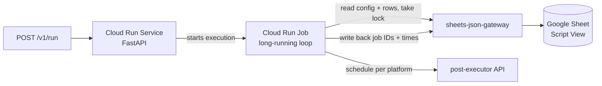

# scheduler-orchestrator

**Last-mile delivery for high-volume content: finished assets go out to six platforms on schedule, tracked per asset, with the team in control from one sheet.**

A content team fills in a "Script View" Google Sheet: one row per post, with captions, media links and target times. This service reads those rows and schedules each post to **YouTube, Instagram, TikTok, Facebook, X and Threads** through a posting executor API. It then writes each platform's job ID and scheduled time back to the sheet, so the sheet always shows what's actually queued.

It is the last stage of the video pipeline: [sf-production-app](https://github.com/metrothenews/sf-production-app) renders the edits, and this publishes them.



**Highlights**

- **Fast trigger, long-running job.** The HTTP service returns immediately and hands the slow work to a Cloud Run Job execution, so callers (cron, a button, another agent) never wait on a request timeout.
- **Deterministic jitter.** Each platform's post time is offset by a jitter derived from a SHA-256 of `(post_id, platform, base_time)`. Posts look natural, and re-running gives the same schedule (idempotent).
- **Sheet-level locking with TTL.** A lock cell stops two triggers from processing the same rows at once. It expires on its own if a run crashes.
- **Config lives in the sheet.** Delays, jitter ranges, time zone and endpoints are key/value rows the content team can change without a redeploy.
- **Clean boundaries.** This service never talks to the Sheets API directly. All reads and writes go through [sheets-json-gateway](https://github.com/metrothenews/sheets-json-gateway). Retries use `tenacity`.

**Stack:** Python 3.11 · FastAPI · httpx · pydantic-settings · Google Cloud Run (Service + Job) · Docker

## Applications at scale

- **The distribution layer for high-volume content.** Generating video is only half of a content pipeline; publishing it reliably to six platforms, each with its own timing, is the other half. This service is that last mile, and it's content-agnostic: human-made or AI-generated posts go through the same contract.
- **Multi-tenant content operations.** One deployment is driven entirely by which sheet it's pointed at, so each brand, artist or client is a spreadsheet, not a code change. That's the model for an agency or a creator-tools product.
- **Agent-triggerable.** The whole run starts from one authenticated HTTP call and reports back in structured rows, so an AI agent can own "publish this week's content" end to end while people keep approval rights in the sheet.
- **Serverless economics.** Service and job scale to zero between runs; cost tracks usage.

**What it demonstrates:** event-driven serverless architecture, idempotent scheduling, distributed locking, retries and backoff, clean service boundaries, config-as-data.

## Environment variables (bootstrap)

### Required (Service + Job)

- `SHEETS_JSON_URL` (example: `https://YOUR-SHEETS-JSON-GATEWAY.a.run.app`)
- `SCRIPT_VIEW_SHEET_ID` (the ID of your Script View sheet)
- `SCRIPT_VIEW_TAB_NAME` (default: `Script View`)

### Optional

- `SHEETS_JSON_API_KEY` (if you want unredacted reads from sheets-json)
- `CONFIG_RANGE_A1` (default: `A1:B30`)
- `POSTS_RANGE_A1` (default: `A40:Z1000`)
- `LOCK_RANGE_A1` (default: `D1:E1`)
- `LOCK_TTL_SECONDS` (default: `7200`)

### Service-only (to trigger the job)

- `ORCHESTRATOR_JOB_NAME` (Cloud Run Job name, e.g. `scheduler-orchestrator-job`)
- `GCP_REGION` (default: `us-east1`)
- `GCP_PROJECT` (optional; falls back to `GOOGLE_CLOUD_PROJECT`)
- `TRIGGER_API_KEY` (optional; if set, `POST /v1/run` requires a matching `X-API-Key` header)

## Script View contract (expected keys in config block)

The job reads `CONFIG_RANGE_A1` as two columns: `key`, `value`.

Important keys (recommended):

- `post_executor_url`
- `post_executor_api_key`   (masked/unmasked handled by sheets-json + `SHEETS_JSON_API_KEY`)
- `drive_proxy_prefix`
- `timezone`
- `delay_base_seconds`
- `delay_jitter_seconds_min`
- `delay_jitter_seconds_max`
- `schedule_jitter_minutes_min`
- `schedule_jitter_minutes_max`
- `schedule_jitter_seconds_min`
- `schedule_jitter_seconds_max`

## Deploy (typical)

### 1) Deploy the Job

Example (from source):

```bash
gcloud run jobs deploy scheduler-orchestrator-job \
  --source . \
  --region us-east1 \
  --command python \
  --args -m,scheduler_orchestrator.job \
  --set-env-vars SHEETS_JSON_URL="https://YOUR-SHEETS-JSON-GATEWAY.a.run.app" \
  --set-env-vars SHEETS_JSON_API_KEY="REDACTED" \
  --set-env-vars SCRIPT_VIEW_SHEET_ID="YOUR_GOOGLE_SHEET_ID" \
  --set-env-vars SCRIPT_VIEW_TAB_NAME="Script View"
```

### 2) Deploy the Service

```bash
gcloud run deploy scheduler-orchestrator \
  --source . \
  --region us-east1 \
  --no-allow-unauthenticated \
  --set-env-vars ORCHESTRATOR_JOB_NAME="scheduler-orchestrator-job" \
  --set-env-vars SHEETS_JSON_URL="https://YOUR-SHEETS-JSON-GATEWAY.a.run.app" \
  --set-env-vars SHEETS_JSON_API_KEY="REDACTED"
```

### 3) Allow the Service's runtime identity to execute the Job

`roles/run.invoker` can execute Cloud Run jobs (permission `run.jobs.run`). You can also use `roles/run.jobsExecutor` if you want a job-specific role. (See Cloud Run IAM roles docs.) 

In practice: grant the **service's runtime service account** permission on the job.

```bash
SERVICE_SA="YOUR_SERVICE_RUNTIME_SA@YOUR_PROJECT.iam.gserviceaccount.com"

gcloud run jobs add-iam-policy-binding scheduler-orchestrator-job \
  --region us-east1 \
  --member "serviceAccount:${SERVICE_SA}" \
  --role "roles/run.invoker"
```

## Trigger

```bash
curl -sS -X POST "https://YOUR_SERVICE_URL/v1/run" \
  -H "Authorization: Bearer $(gcloud auth print-identity-token)" \
  -H "Content-Type: application/json" \
  -d '{"command":"scheduler-orchestrator-run"}'
```

The service is deployed with Cloud Run IAM, so callers need `roles/run.invoker` and an identity token. If a caller can't send one (for example a simple webhook), deploy with `--allow-unauthenticated` **and** set `TRIGGER_API_KEY`; requests must then send a matching `X-API-Key` header or get `401`.

## Notes

- The job implements **deterministic** per-platform schedule jitter based on `(post_id, platform, base_time)`.
- The job also implements a **sheet lock** so two triggers can't process the same rows concurrently.
